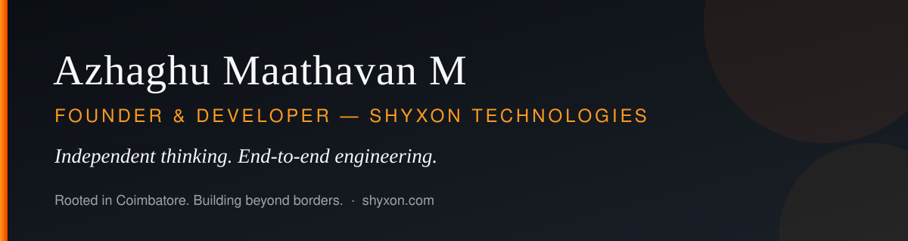

  

### Design that clicks. *Software that works.*

I'm **Azhaghu Maathavan M**, founder and developer at **[ShyXon Technologies](https://shyxon.com)** in Coimbatore. I build websites, applications, and custom software for businesses worldwide.

**A developer's mind. A founder's drive.** My idea of starting ShyXon Technologies was to create dependable websites, web apps, and mobile experiences from ideas. Though physically located in Coimbatore, I serve clients worldwide — from startups to big companies. Being a developer and founder, I manage projects from start to finish: planning, working with designers, coding, and releasing. I am passionate about writing clean code, efficiency, and delivering products that genuinely address problems.

 

## What we can build together

**01 — Website Design & Development**
Distinctive business websites, designed around your audience and engineered for a clear, responsive experience.

**02 — Custom Software Development**
Web applications, dashboards, and business tools built around the way your organization works.

**03 — ERP Solutions**
Connected business workflows and operational software that bring information, teams, and decisions into one system.

**04 — Mobile Application Development**
iOS, Android, and cross-platform applications with considered user journeys and dependable technical foundations.

**05 — Business Digital Transformation**
Technology strategy, connected infrastructure, and practical automation that help your business work more effectively.

## Selected work

*Different businesses. Individual answers.*

<table>
  <tr>
    <td width="50%" valign="top">
       
      <b><a href="https://www.speedeaglepestcontrol.com">Speed Eagle Pest Control LLC</a></b> 
      Service business website designed for local reach, trust, and easy customer contact. 
      Pest control &amp; property care
    </td>
    <td width="50%" valign="top">
       
      <b><a href="https://vibezon.academy">Vibezon Academy</a></b> 
      Live mentorship, courses, community and accountability tools — everything you need to go from zero to running your own business. 
      Education &amp; mentorship
    </td>
  </tr>
  <tr>
    <td width="50%" valign="top">
       
      <b><a href="https://milesawaycargo.com">Miles Away Cargo</a></b> 
      Cargo and logistics company website built to showcase shipping services, build trust, and connect with clients worldwide. 
      Cargo &amp; logistics
    </td>
    <td width="50%" valign="top">
       
      <b><a href="https://karpagam.shyxon.com">Karpagam Multiplex</a></b> 
      A cinema website bringing the theatres, Grandplex experience, and visitor information together. 
      Cinema &amp; entertainment
    </td>
  </tr>
  <tr>
    <td width="50%" valign="top">
       
      <b><a href="https://sakalyadental.shyxon.com">Sakalya Dental</a></b> 
      A website for a dental clinic, presenting dental treatments, clinic information, and appointment enquiries. 
      Dental care
    </td>
    <td width="50%" valign="top">
       
      <b><a href="https://richmondhospitals.shyxon.com">Richmond Hospitals</a></b> 
      A hospital website organising specialities, doctor information, and appointment enquiries. 
      Healthcare
    </td>
  </tr>
  <tr>
    <td width="50%" valign="top">
       
      <b><a href="https://saazkitchen.shyxon.com">SAZZ Kitchen &amp; Lounge</a></b> 
      A restaurant website exploring menus, dining spaces, and table enquiries. 
      Dining &amp; hospitality
    </td>
    <td width="50%" valign="top">
       
      <b><a href="https://beyondthestories.shyxon.com">Beyond the Stories</a></b> 
      A website for a bistro and rooftop lounge, showcasing its spaces, menu, and atmosphere. 
      Bistro &amp; rooftop lounge
    </td>
  </tr>
  <tr>
    <td width="50%" valign="top">
       
      <b><a href="https://alumni.shyxon.com">Alumnivo</a></b> 
      An alumni community connecting graduates through networking, mentorship, jobs, and events. 
      Community &amp; education
    </td>
    <td width="50%" valign="top">
       
      <b><a href="https://photazo.in">Photazo</a></b> 
      Professional real estate photo editing website showcasing HDR, virtual twilight, and retouching services for property professionals. 
      Real estate photography
    </td>
  </tr>
</table>

<a href="https://shyxon.com/work">Explore all the work on shyxon.com →</a>

## The way forward

*Thought through. Then built through.*

**Understand** — Your goals, your users, and the work that needs to happen. →
**Design** — A clear direction, explored through interfaces and prototypes. →
**Develop** — The architecture, code, integrations, and testing underneath. →
**Launch & evolve** — A careful release, practical handover, and room to grow.

## My stack

  
  
  
  
  
  
  
  
  
  
  
  
  
  
  

## GitHub stats

  
  

## Connect

- 🌐 **Website** — [shyxon.com](https://shyxon.com)
- 👤 **Founder profile** — [shyxon.com/azhaghumaathavan](https://shyxon.com/azhaghumaathavan)
- ✉️ **Email** — [contact@shyxon.com](mailto:contact@shyxon.com)
- 📞 **Phone** — [+91 94889 59073](tel:+919488959073)
- 📸 **Instagram** — [@shyxontechnologies](https://www.instagram.com/shyxontechnologies/)

---

<i>Digital experiences. Dependable engineering.</i>

Most of my production work for ShyXon and its clients lives in private repositories — the work above is its public face.

